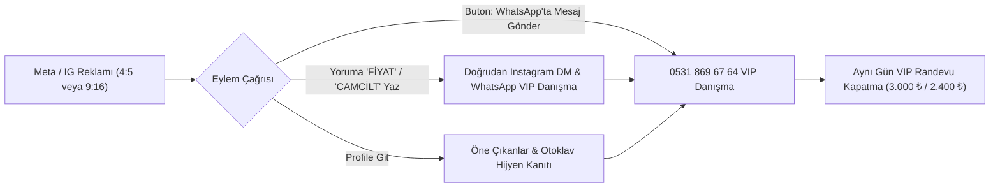

# 🎯 20 KASIM LİNAİL BEAUTY REKLAM KAMPANYASI ÇALIŞMA DEFTERİ
## Uphill Towers Ataşehir VIP Müşteri Edinme & Ciro Kapatma Stratejisi

> **Tarih:** 20 Kasım 2026 Başlangıç  
> **Konum:** Uphill Towers B Blok D:14, Barbaros Mah. Ataşehir / İstanbul  
> **WhatsApp VIP:** +90 531 869 67 64 (`https://wa.me/905318696764`)  
> **Instagram:** `@linail.beautystudio`  
> **Finansal Hedef:** Günde 5 Nitelikli VIP Randevu = Günlük 12.000 – 15.000 ₺ / Aylık ~350.000 ₺ Ciro

---

## 1. YÜRÜTME FELSEFESİ (SIFIR AI KLİŞESİ — %100 BUTİK GERÇEKLİK)
* Bu reklam setlerinde yapay zekanın ezberlediği sahte modeller, pembe parıltılı stock videolar, *"kendinizi şımartın"*, *"büyük bir keyifti"*, *"değerli danışanımız"* gibi soğuk ve yapay robotik cümleler **KESİNLİKLE KULLANILMAYACAKTIR.**
* **Dilimiz:** Ataşehir'de tırnak masasının karşısında kahve ikram eden, Uphill Towers manzarasında steril paketleri açan, işinin ehli zanaatkar usta sesi (**Gülşah Taşan**).
* **Görsellerimiz:** Kabindeki gerçek cihazlar (Mormed 7-in-1, Genosys, IC Factory, Otoklav poşetleri) ve stüdyonun kendi çekimleri.

---

## 2. BÜTÇE DAĞILIMI VE KAMPANYA MİMARİSİ (20 KASIM TESTİ)

### A. Günlük Bütçe Planı (300 ₺ / Gün ile Başlangıç)
* **Kreatif Set 1 (Kore Cam Cilt - 3 Seanslık Kür):** 120 ₺ / Gün
* **Kreatif Set 2 (Rus Kuru Manikür & Jel Güçlendirme):** 100 ₺ / Gün
* **Kreatif Set 3 (IC Factory Kaş Laminasyon & İpek Kirpik):** 80 ₺ / Gün
* **Toplam 7 Günlük Test Bütçesi:** 2.100 ₺  
* **Beklenen Dönüşüm:** 7 günde 15–20 sıcak WhatsApp konuşması $\rightarrow$ En az 6–8 VIP randevu satışı $\rightarrow$ **18.000 – 24.000 ₺ Doğrudan Nakit Girişi** (ROAS: 8x – 11x).

---

## 3. COĞRAFİ HEDEFLEME & GEOFENCING (ATAŞEHİR ÇEMBERİ)
* 🚨 **Ölümcül Kural:** Asla Türkiye geneline veya İstanbul geneline çıkılmaz! Maslak'taki veya Bakırköy'deki kadına Ataşehir tırnak reklamı göstermek bütçeyi çöpe atmaktır.
* **Merkez Nokta:** Ataşehir Uphill Towers (`40.9930, 29.1170`)
* **Yarıçap:** Maksimum **+3.5 km ila +5.0 km**.
* **Kitle Büyüklüğü Limiti:** **120.000 – 350.000 kişi** (Meta ekranında 1 milyonun üzerine çıkıyorsa broad sızıntısı vardır, derhal daraltılır).
* **Öncelikli Odak Siteler:**
  - Uphill Court & Uphill Towers sakinleri
  - Varyap Meridian
  - Metropol İstanbul (Finans Merkezi çalışanları)
  - Ağaoğlu My World / My Towerland
  - Brandium Ataşehir
  - Batı Ataşehir ve Ihlamur Bulvarı hattı.
* **Demografi:** Kadın, 22 – 52 yaş. Dil: Türkçe (Yabancı dil arayan bot hesaplar filtrelenir).

---

## 4. PARA YUTAN ÇÖP ARAMALARI ENGELLEME (NEGATİF LİSTESİ)
Reklam seti ve anahtar kelime seviyesinde şu aramalar derhal negatiflenir:
* **Kuaför / Saç Kesimi / Fön / Boya:** Linail saç hizmeti vermez.
* **Toptan Malzeme / Jel Satışı:** Tırnak malzemesi arayan esnaf engellenir.
* **Kurs / Eğitim / Sertifika:** Protez tırnak kursu arayanlar filtrelenir.
* **Erkek Hizmetleri:** Berber, erkek manikür, erkek epilasyon tamamen engellenir.
* **Ucuzluk Arayıcıları:** "Ucuz protez tırnak", "indirimli tırnak kuponu" arayan düşük bütçeli kitle elenir.

---

## 5. DÖNÜŞÜM HUNİSİ (CONVERSION ARCHITECTURE)

* **Kural:** Reklam asla web sitesinde kaybolmaya veya profile girip unutulmaya bırakılmaz. Tek nihai hedef: **WhatsApp veya DM konuşması açmaktır.**
