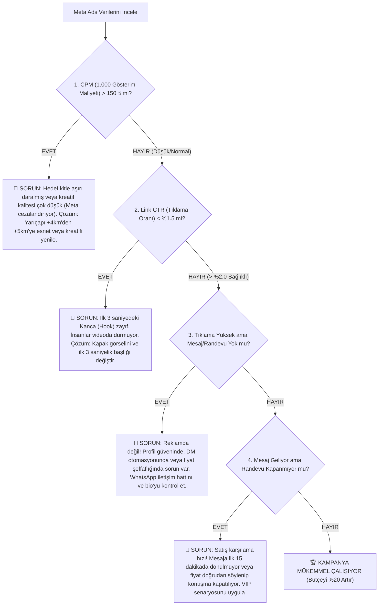

# 📊 GÜNLÜK TAKİP VE METRİK TEŞHİS DEFTERİ (20–30 KASIM)
## Sınırsız Müşteri (Mustafa Öztürk) Teşhis Protokolü

Reklamlar yayına alındıktan sonra ezbere *"iyi gidiyor"* veya *"kötü gidiyor"* denmez. Her sabah saat 10:00'da şu hiyerarşik teşhis zinciriyle kontrol edilir:

---

## 1. METRİK TEŞHİS HİYERARŞİSİ (SORUN NEREDE?)

---

## 2. GÜNLÜK PERFORMANS TAKİP ÇİZELGESİ (KOPYALANIP DOLDURULACAK)

| Tarih | Harcanan (₺) | Gösterim | CPM (₺) | Link Tıklama | CTR (%) | Başlatılan Mesaj | Kapanan Randevu | Elde Edilen Ciro (₺) | Durum & Aksiyon Notu |
|---|---|---|---|---|---|---|---|---|---|
| **20 Kas (1. Gün)** | | | | | | | | | *İlk gün öğrenme fazı, müdahale etme.* |
| **21 Kas (2. Gün)** | | | | | | | | | *Kreatiflerin CTR oranlarını karşılaştır.* |
| **22 Kas (3. Gün)** | | | | | | | | | *En yüksek mesaj getiren kreatifi belirle.* |
| **23 Kas (4. Gün)** | | | | | | | | | *Düşük kalan kreatifi durdur, bütçeyi kazanana aktar.* |
| **24 Kas (5. Gün)** | | | | | | | | | *Hafta sonu randevu doluluğunu kontrol et.* |
| **25 Kas (6. Gün)** | | | | | | | | | *ROAS hesapla (Ciro / Harcanan Reklam).* |
| **26 Kas (7. Gün)** | | | | | | | | | *Haftalık değerlendirme & bütçe ölçekleme.* |

---

## 3. WHATSAPP & DM SATIŞ KAPATMA KURALLARI (GÜLŞAH İÇİN)

Müşteri DM veya doğrudan reklam üzerinden WhatsApp'a yazdığında:

1. **İlk 15 Dakika Kuralı:** Gelen mesaja ilk 15 dakika içinde dönülmelidir. 1 saat sonra dönülen müşterinin satın alma isteği %60 düşer.
2. **Asla Kuru Fiyat Yazıp Bırakmayın:**
   - ❌ Hatalı: *"Protez tırnak 3.000 TL."* (Müşteri 'teşekkürler' der ve gider).
   - ✅ Doğru VIP Yaklaşım: *"Merhaba Ezgi Hanım ✨ Protez tırnak işlemimiz Uphill Towers'taki stüdyomuzda kişiye özel otoklav steril aletlerle ve Rus kuru manikür tekniğiyle etler kesilmeden uygulanır. Kalıcı oje ve manikür dahil 3.000 TL'dir. Bu hafta Perşembe 14:00 veya Cuma 16:30 sizin için uygun olur mu?"*
3. **Fiyat Çıpalama Tekniği:**
   - Danışan 3.000 ₺'yi yüksek bulursa: *"Eğer tırnak plağınız güçlüyse kendi tırnağınızı kırmadan uzatan Jel Güçlendirme bakımımızı da düşünebilirsiniz; manikür ve kalıcı oje dahil 2.400 TL'dir."* (Böylece müşteri kaçmaz, 2.400 ₺'ye randevu kapatılır).
