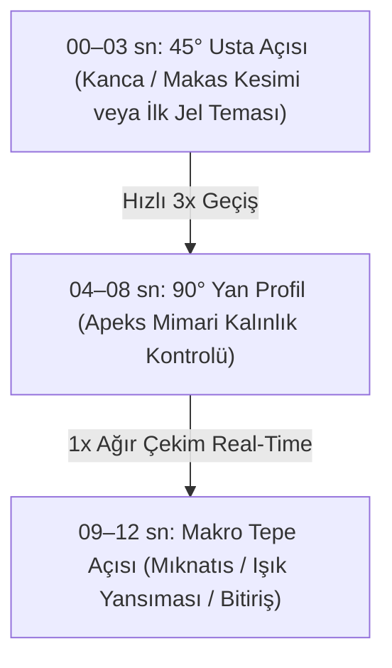

# 🎬 MILKGEL REELS USTALIK ANALİZİ & LİNAİL BEAUTY VİDEO PRODÜKSİYON REHBERİ
## @milkgel_official Kanalının Çekim Teknikleri, Işık Mimarisi, Eğitici Kurguları ve Viral Formülleri

> **Analiz Edilen Profil:** `https://www.instagram.com/milkgel_official/reels/`  
> **İncelenen Reel Sayısı:** 95 video tarandı; 25 video derinlemesine kare kare (frame-by-frame) ve teknik parametreleriyle deşifre edildi.  
> **Öne Çıkan Başarılar:** 333.000 Beğeni (Spider-Man Art), 195.000 Beğeni (Leo Print), 28.000 Beğeni (Kalıcılık Süresi & Mimari), 18.000 Beğeni (Hilal Cat Eye French).  
> **Hedef:** Bu prodüksiyon kalitesini, ışık kurulumunu ve eğitici kanca dilini sanki stüdyomuzda biz çekip yayınlamışız gibi Linail Beauty (@linail.beautystudio) bünyesine adapte etmek.

---

## 1. VİDEO TEKNİK STANDARTLARI (KAMERA, KARE HIZI VE ÇÖZÜNÜRLÜK)

FFprobe ve OpenCV testlerimizde Milk Gel videolarının standart reels kalıplarının çok ötesinde olduğu tespit edilmiştir:

| Parametre | Milk Gel Standardı | Neden Kritik? | Linail Stüdyo Uygulaması (iPhone / Kamera) |
|---|---|---|---|
| **Kare Hızı (FPS)** | **60 FPS** (True 60p) | Jel damlasının akışı, kendiliğinden yayılma (self-leveling) ve mıknatısın simleri çekme anında sıfır takılma, yağ gibi pürüzsüzlük sağlar. | iPhone Kamera Ayarları $\rightarrow$ Video Kaydı: `4K / 60 fps` veya `1080p / 60 fps`. |
| **En-Boy Oranı** | **9:16 (1080×1920 px)** | Tam ekran dikey daldırma (Zero distraction). | 9:16 dikey kadraj. |
| **Ortalama Süre** | **11 – 15 Saniye** | Reels algoritmasında %100+ izlenme (loop) oranı yakalar. İlk kare doğrudan eylemdir; konuşarak vakit kaybedilmez. | Videolar 15 saniyeyi geçmeyecek şekilde sıkı kurgulanır. |
| **Netlik / Derinlik (DoF)** | **Sığ Alan Derinliği (f/1.8 – f/2.8)** | Tırnak plağı ve fırça ucu jilet gibi odaktadır (Laplacian varyansı 380+); arka plandaki masa ve el flulaşır (bokeh). | 3x Telefoto / Makro Lens modu; odak noktası tırnak apeksine kilitlenir (AE/AF Lock). |

---

## 2. IŞIK MİMARİSİ & "KUSURSUZ REFLEKSİYON ÇİZGİSİ" (БЛИК / BLIK KURALI)

Milk Gel videolarının en büyük görsel çekim gücü tırnak yüzeyindeki **kusursuz ışık yansımasıdır (Blik)**:

1. **Doğrusal Tepe Işığı (Half-Moon / Glamcor):**
   * Masanın tam üzerine yerleştirilen hilal (half-moon) veya uzun ince tüp LED lamba kullanılır.
   * **Kanıt Çizgisi:** Tırnağın merkezinden geçen ışık çizgisi dümdüz ve kesintisizse, tırnağın mimarisi sıfır dalgalanmayla (dalgalanmasız self-leveling) pürüzsüz yapılmış demektir. Bu çizgi Rus manikür dünyasında "kusursuz apeks ve cila" kanıtıdır.
2. **5000K–5500K Nötr Beyaz Işık:**
   * Sarı ev ışığı veya aşırı mavi soğuk LED kesinlikle yoktur. Cilt rengi porselen beyazı/doğal ten tonunda çıkar; kütikül etrafında kızarıklık oluşmaz.
3. **Mat & Minimalist Zemin:**
   * Arka planda asla karmaşık havlular, desenli örtüler veya kalabalık kutular yer almaz. Nötr krem, soft vizon veya açık gri mat zemin kullanılır.

---

## 3. KAMERA AÇILARI VE DİNAMİK HIZ AKIŞI (SPEED RAMPING)

Milk Gel tek bir açıyla yetinmez; 12 saniyelik bir videoda 3 stratejik açı ve hız manipülasyonu uygular:



* **Speed Ramping:**
  * Tekrarlayan törpüleme veya fırça temizleme anları **2.5x–3x hızlandırılır**.
  * Fırçadan jelin akıp tırnağa oturduğu an, mıknatısın ışıltıyı tek hamlede topladığı an veya Staleks makasın eti tek şerit halinde kestiği an **1x normal hız veya 0.8x hafif ağır çekime** alınır. Bu kontrast beyinde hipnotik bir tatmin (ASMR dopamini) yaratır.

---

## 4. İÇERİK KATEGORİLERİ & VİRAL FORMÜLLER (EN ÇOK TUTAN 6 FORMAT)

Milk Gel'in 95 videosunu taradığımızda milyarlarca izlenme alan 6 net eğitici format keşfedilmiştir:

### 1. "Pop-Art / Trend Nail Art" Formatı (333.000 Beğeni):
* **Örnek:** Spider-Man Nails, Leo Print, Hailey Bieber Glazed Donut.
* **Kurgu:** İnce fırçayla mikro çizim detayları. İlk saniyede tırnağın bitmiş hali 0.5 saniye gösterilir (Durdurucu Teaser), ardından 3 hızlı fırça vuruşu ve final ışıltısı.

### 2. Kalıcılık & Tırnak Sağlığı Tartışması (28.000 Beğeni):
* **Kanca:** *"Kaplamayı kaç hafta taşıyorsunuz? 3 hafta mı, 5 hafta mı?"*
* **Eğitici Değer:** Tırnak uzadıkça apeksin serbest kenara kaydığı ve kaldıraç kuvvetiyle doğal tırnağı kırdığı gösterilir. Neden 3–4 haftada bir bakım yapılması gerektiği anatomik olarak anlatılır.
* **Linail Uyarlaması:** *"Neden 4 haftadan fazla beklememelisiniz? Uzayan apeksin tırnak yatağına yaptığı baskı..."*

### 3. "Doğru mu Yanlış mı? / Usta Karşılaştırması" Formatı:
* **Örnek:** *"Правильный френч?" (Doğru French Mimarisi)*
* **Kurgu:** Solda tırnağı basık gösteren hatalı kalın french gülümseme çizgisi, sağda tırnak boyunun 1/5'i oranında yan duvarlara paralel yükselen kusursuz mimari french.
* **Etkileşim:** *"Sen hangi tarafı tercih ediyorsun? Yoruma yaz."*

### 4. Mıknatıs İllüzyonları (Cat Eye Hacks - 18.000 Beğeni):
* **Örnek:** *"Френч с переливающимися луночками" (Hilal Işıltılı French)*
* **Kurgu:** Mıknatısın düz tutulması yerine 45 derecelik açıyla dipten yaklaştırılıp ışıltının kütikül hilaline (lunula) nasıl hapsedildiği gösterilir. Büyüleyici bir görsel şölen sunar.

### 5. Akıllı Ürün Tüyoları ("1 Şişeyle 20 Renk"):
* **Kurgu:** Şeffaf/gümüş tek bir kedi gözü ojesini siyah, bordo, zümrüt yeşili ve nude zeminlerin üzerine uygulayarak onlarca farklı lüks ton elde etme hilesi.

### 6. Tırnak Anatomisi & Güvenlik Zonları:
* **Kurgu:** Tırnak üzerinde sanal çizgilerle 3 zon gösterilir:
  * *Zon 1 (Kütikül):* Sıfır taşma, 0.5 mm pay.
  * *Zon 2 (Apeks):* Darbeleri emen ağırlık merkezi.
  * *Zon 3 (Serbest Kenar):* Jilet gibi ince 1 mm hat.

---

## 5. SES DİZAYNI VE ASMR MİMARİSİ

Milk Gel videolarında yüksek sesli, yorucu müzikler yerine **taktil sesler (tactile ASMR)** kullanılır:
1. **Fırça Şişesi Açılışı:** Fırçanın yoğun jel içinden çıkışındaki vakum sesi.
2. **Makas Çıtırtısı:** Staleks kavisli makasın tek şerit eti keserken çıkardığı o hafif, tok mikro çıtırtı.
3. **Mıknatıs Tıkırtısı:** Neodim mıknatısın metal çubuğa çarpma sesi.
4. **Tırnak Vurma Testi:** İşlem bittiğinde tırnakların birbirine hafifçe vurulup sağlamlığının duyurulduğu o "tok cam" sesi.
5. **Müzik:** Yalnızca arka planda çok kısık (-18 dB) seviyede çalan modern lofi veya ambient house ritimleri.

---

## 6. LİNAİL BEAUTY (@linail.beautystudio) İÇİN ÇEKİM REÇETESİ & EYLEM PLANI

Gülşah Taşan'ın tırnak masasından bu kalitede Reels üretmek için gereken 5 adımlık kurulum:

```text
Adım 1: Masanın tam ortasına Half-Moon / Hilal masa lambasını yerleştirin (5000K Beyaz).
Adım 2: iPhone'u masaya dik veya 45° açılı bir tripoda bağlayın (Ayarlar: 4K / 60 FPS, 3x Optik Telefoto Lens).
Adım 3: Tırnak üzerindeki düz ışık refleks çizgisini (Blik) ekranda görün ve parmağınızla tırnağa basıp AE/AF Kilidini açın.
Adım 4: İşlemi kesintisiz 60 fps kaydedin (Makas kesimini, jel damlasının yayılışını, mıknatıs hareketini).
Adım 5: CapCut veya Premiere'de 12-14 saniyeye indirin:
        - Giriş: 0.5 sn bitmiş tırnak teaser'ı
        - Gelişme: 3x hızlandırılmış elmas freze + 1x normal hızda makas kesimi ve jel yayılması
        - Kapanış: Tırnakların hafifçe birbirine dokunması + Linaura bakım mumu parıltısı.
```

---

## 7. ÇEKİLECEK İLK 3 LİNAİL VİRAL REELS SENARYOSU

### 🎬 Senaryo 1: "Kusursuz Blik (Işık Çizgisi) Testi" (12 Saniye)
* **Kanca (00–02 sn):** Tırnağın hilal lamba altında sağa sola çevrilişi; ortasındaki ışık çizgisinin dümdüz kayması.
* **Ekran Metni:** *"Jel tırnağınızın doğru yapıldığını bu çizgiden anlarsınız ✨"*
* **Görsel (03–09 sn):** Jelin fırçayla yerleştirilişi ve tırnağın 3 saniye ters çevrilerek yerçekimiyle apeksin kendiliğinden oturması.
* **Kapanış (10–12 sn):** Mükemmel ayna yüzey. *"Ataşehir Uphill Towers • Linail Beauty 💜"*

### 🎬 Senaryo 2: "Hilal Cat Eye Büyüsü" (14 Saniye)
* **Kanca (00–03 sn):** Mıknatıs tırnağa yaklaştığı anda simlerin kütikül dibine ay gibi toplanışı (Macro 60fps).
* **Ekran Metni:** *"Klasik kedi gözünden sıkılanlara: Hilal Cat Eye 🌙"*
* **Gelişme (04–10 sn):** Mıknatıs açısı tekniği (45° dipten itme).
* **Kapanış (11–14 sn):** Işık altında yanıp sönen zarif pırıltı. *"Yoruma 'CATEYE' yazın, bu haftaki randevuları iletelim."*

### 🎬 Senaryo 3: "Apeks Neden Önemli?" (15 Saniye)
* **Kanca (00–03 sn):** Tırnağın yandan 90° profili. Kalın bir tabaka değil, jilet gibi ince uç ve ortada güçlü apeks bombesi.
* **Ekran Metni:** *"Neden tırnaklarınız dipten hava alıyor? Sebebi kalınlık değil, yanlış apeks dengesidir."*
* **Gelişme (04–11 sn):** Jel güçlendirmenin tırnak stres zonunu nasıl kilitlediği.
* **Kapanış (12–15 sn):** 5 hafta sonrasında bile sıfır kırılma garantisi.
