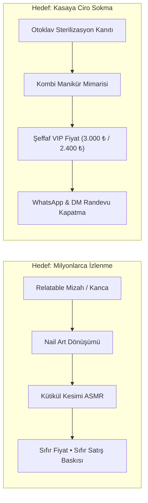

# 🚀 BEATRIZ MARKETING PROMPTLARI & YANINA RAI ÇEKİM MİMARİSİ
## Linail Beauty & Gülşah Taşan İçin AI Kanca Motoru, ManyChat Hunileri ve Profesyonel Telefon Çekim Standartları

> **Tarih:** 7 Kasım 2026  
> **İncelenen Hesaplar:**  
> 1. `https://www.instagram.com/beatrizbmkt/reels/` (50 Reels • Yapay Zeka Pazarlama Promtları, ManyChat Huni Mimarisi, Viral vs Satış Video Dengesi)  
> 2. `https://www.instagram.com/yanina_rai/reels/` (95 Reels • Güzellik Uzmanları İçin Profesyonel Telefon Açıları, Tripod Yerleşimi, Blik Işık Mimarisi)  
> **Hedef:** Beatriz'in viral dönüşüm hunilerini ve Yanina Rai'nin telefonla stüdyo çekim geometrisini Linail Beauty stüdyosuna tam entegre etmek.

---

## BÖLÜM 1: BEATRIZ MARKETING'DEN ÇIKARILAN 3 STRATEJİK DÖNÜŞÜM KURALI

### Kural 1: "2 Video, 2 Farklı Hedef" Stratejisi (Beatriz'in 829 Beğenili Temel İlkesi)
Piyasadaki güzellik salonlarının yaptığı en büyük hata **her videoda satış yapmaya çalışmaktır.** Bu strateji izleyiciyi sıkar ve algoritmayı öldürür.



* **Video 1 (Keşif / Viral):** Satış yapmaz! *"Tırnaklarını yaptırdıktan 2 saat sonra ev temizleyenler"*, Cat Eye mıknatıs illüzyonu veya Spider-Man çizimi. Amacı hesaba binlerce yeni kadın çekmektir.
* **Video 2 (Dönüşüm / Satış):** Güven verir, hijyeni gösterir, fiyatı açıklar, apeks mimarisini kanıtlar ve VIP randevu kapatır.

---

### Kural 2: ManyChat Tek Kelime Yorum Hunisi (Comment-to-DM)
Beatriz'in tüm reels'lerinde ilk satır aynıdır: `Comenta "IA" para desbloquear...`
* **Algoritma Hilesi:** Yoruma tek bir kelime yazdırmak izleyicinin yorum yapma sürtünmesini (friction) sıfıra indirir. Yorum sayısı patladığı an Instagram videoyu Keşfet'e fırlatır.
* **ManyChat Otomasyonu:** Yorumu yazan kişiye 3 saniye içinde DM'den özel katalog veya randevu takvimi düşer.
* **Linail Tetikleyicileri:**
  - Cilt için: **"CAM CİLT"**
  - Tırnak için: **"TIRNAK"**
  - Kaş & Kirpik için: **"LİFTİNG"**

---

### Kural 3: Linail Beauty İçin Uyarlanmış 3 Gizli Prompt Şablonu

#### 📌 Prompt 1: "Scroll-Stopper (Kaydırma Durdurucu) Kanca Üretici"
```text
Sen Ataşehir Uphill Towers'ta VIP tırnak ve cilt stüdyosu işleten usta bir zanaatkarsın.
Bana hedef kitlesi Ataşehir ve Finans Merkezi'nde çalışan yüksek alım gücüne sahip kadınlar olan 
5 adet Instagram Reels açılış kancası yaz.
Kurallar:
- İlk 3 saniyede izleyicinin günlük bir acısına veya merakına dokunmalı.
- Asla "kendinizi şımartın", "kusursuz güzellik" gibi yapay zeka klişeleri kullanma.
- Tırnak etinin parçalanması, sabah rimelle uğraşma veya makyajsız cam gibi parlama hissi üzerine odaklan.
- Samimi, zanaatkar, sıcak butik bir Türkçeyle yaz.
```

#### 📌 Prompt 2: "Fiyat İtirazını Meşrulaştırma (3.000 ₺ Çıpalama)"
```text
Bir müşteri adayı "Neden protez tırnak 3.000 TL, diğer yerlerde 1.000 TL'ye de var?" diye sorduğunda 
ona savunmaya geçmeden, lüks bir zanaatkar zarafetiyle verilecek WhatsApp yanıtını yaz.
Vurgulanacak unsurlar:
1. Her aletin kişiye özel otoklav poşetinden çıkması (sıfır mantar, sıfır hepatit riski).
2. Kombi Rus maniküründe Staleks makasla tek şerit kesim yapılması (et kanaması yok, 3 gün sonra parçalanma yok).
3. Tırnağın kalın bir kalıp değil, jilet gibi ince mimari apeksle yapılıp 5 hafta dipten tek milim hava almaması.
4. Gülşah Taşan'ın günde yalnızca 5 kişiye özel zaman ayırması.
```

---

## BÖLÜM 2: YANINA RAI'DEN ÇIKARILAN ÇEKİM AÇILARI & TELEFON GEOMETRİSİ

Yanina Rai'nin 39.000 ve 24.000 beğeni alan videolarında öğrettiği **Güzellik Masası Kamera Kurulumu**:

### 1. Tripod ve Telefon Yerleşimi (BTS Geometrisi)

```text
       [ TAVAN / TEPE HİLAL LAMBA (5000K) ]
                      |
                      v (25 cm mesafe)
        [ TELEFON (BAŞ AŞAĞI TERS MONTE) ]  <--- Masa Mengeneli Pantograf Kol
                      |
                      v 45° Açı
           [ GÜLŞAH HANIM'IN ELLERİ ]
                      |
           [ DANIŞANIN PARMAKLARI ]  <--- 15° Yukarı Tilt (Kameraya Doğru Kavis)
                      |
         [ NÖTR KREM / VİZON MAT ZEMİN ]
```

1. **Ters Telefon Montajı (Inverted Mount):**
   * Telefon tripoda normal takıldığında lens yukarıda kalır ve tırnağa uzaktan bakar.
   * **Yanina Rai Hilesi:** Telefon tutucuya **baş aşağı (ters)** takılır! Böylece lens masaya 5 cm daha yaklaşır, tırnağa neredeyse zemin hizasından makro bakış sağlar.
2. **Masa Mengeneli Pantograf Kol (Boom Arm):**
   * Yerde duran üçayak tripod masaya çarptıkça titrer.
   * Masanın arkasına mengeneyle sabitlenen hareketli metal pantograf kol sıfır sarsıntı sağlar.
3. **Mesafe:** Telefon ile tırnak arası mesafe **20 – 25 cm** olmalıdır. Daha yakın olursa fırçanın hareket alanı daralır, daha uzak olursa makro detay kaybolur.

---

### 2. iPhone Kamera Ayarları (Yanina Rai Standardı)

* **Çözünürlük & Kare Hızı:** `4K / 60 FPS` (Ayarlar $\rightarrow$ Kamera $\rightarrow$ Video Kaydı).
* **Lens Seçimi:** Asla 1x dijital zoom yapılmaz! **3x Optik Telefoto Lens** seçilir. Bu lens tırnağın kenarlarında balıkgözü bükülmesi (distorsiyon) yapmaz, tırnağı cetvel gibi düz gösterir.
* **Pozlama (Exposure Compensation):** Tırnağın üzerine dokunulduğunda çıkan güneş simgesi **-0.3 veya -0.7 EV hafifçe aşağı çekilir.**
  * *Neden?* iPhone otomatik pozlamada tırnak cilasını patlatır (beyaz leke yapar). Işığı hafif kısarsanız tırnağın üzerindeki parlak ayna çizgisi (Blik) jilet gibi netleşir.
* **AE/AF Kilidi:** Tırnağın merkezine 2 saniye basılı tutulup **AE/AF KİLİTLENDİ** yazısı görülmelidir. Fırça girip çıktıkça kameranın ileri geri odak araması (focus hunting) engellenir.

---

### 3. Danışanın El Duruşu (Posing & Ergonomi)

* Danışan elini yumruk yapmamalı veya parmaklarını kasmamalıdır.
* **İdeal Poz:** Parmaklar hafif içe kıvrık, tırnak uçları 15° kameranın lensine doğru bakar vaziyette durmalıdır. Bu açı, tırnağın hem üst yüzeyindeki pürüzsüz cila çizgisini hem de yan kavisindeki mimari apeksi tek karede gösterir.

---

### 4. Yanina Rai'nin En Vurucu İlkesi

> *"Çok kaliteli işler yapabilirsiniz ama fotoğrafta ve videoda gösteremiyorsanız; müşteriler sizden daha kalitesiz yapan ama daha iyi video çekenlere gider!"*  
> — **Yanina Rai**

Bu kural Linail Beauty için bir kanundur. Masadaki zanaat ne kadar yüksekse, telefonun arkasındaki çekim disiplini de o kadar yüksek olmak zorundadır.
