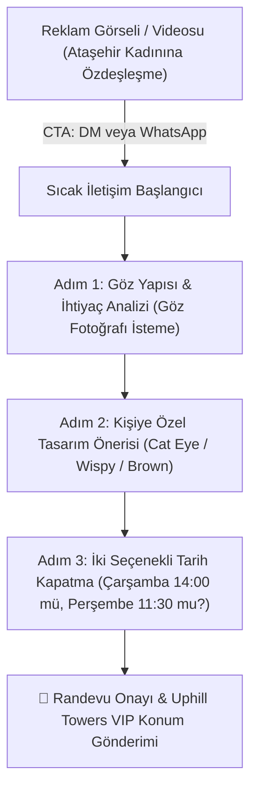

# 👁️ LİNAİL BEAUTY • İPEK KİRPİK RANDEVUYA DÖKME & REKLAM TASLAKLARI
## Ataşehir Uphill Towers VIP Müşteri Edinme ve Aynı Gün Randevu Kapatma Master Planı

> **Hedef:** Boş beğeni veya profil ziyareti toplamak DEĞİL; reklamı gören Ataşehirli kadını **aynı gün WhatsApp veya Instagram DM üzerinden randevuya bağlamak.**  
> **Konum & Geofence:** Ataşehir Uphill Towers merkezli +4 km yarıçap (Uphill Court, Varyap Meridian, Metropol İstanbul, Ağaoğlu My World, Batı Ataşehir).  
> **İletişim Hattı:** WhatsApp VIP: `+90 531 869 67 64` (`https://wa.me/905318696764`) & Instagram DM: `@linail.beautystudio`  
> **Felsefe:** ManyChat botları YOK. Masada kahvesini ikram eden usta artisan sesiyle %100 organik, sıcak ve profesyonel insan diyaloğu.

---

## 1. NASIL RANDEVUYA DÖKÜLÜR? (DÖNÜŞÜMÜ KİLİTLEYEN 4 PSİKOLOJİK ADIM)

Bir kadının ipek kirpik reklamını görüp randevu almasını engelleyen 3 büyük korku vardır:
1. *"Gözlerim yanar mı, kirpiklerim dökülür mü?"* $\rightarrow$ **Çözüm:** Hassas göz pedi ve medikal hipoalerjenik yapıştırıcı vurgusu.
2. *"Çok abartılı ve yapay (tırtıl gibi) durur mu?"* $\rightarrow$ **Çözüm:** *"She still looks like herself — just elevated"* felsefesi; kahverengi naturel ve wispy model kanıtı.
3. *"Hangi model bana yakışır bilmiyorum."* $\rightarrow$ **Çözüm:** Ücretsiz göz yapısı analizi daveti.

### 🔄 Randevu Akış Şeması


---

## 2. REKLAM KREATİF TASLAKLARI (3 FARKLI AÇI VE FORMAT)

---

### 🎨 REKLAM TASLAĞI 1: VİRAL REELS VİDEOSU (9:16 DİKEY)
* **Kreatif Türü:** 9:16 Video (12–14 Saniye) • True 60 FPS
* **Kamera Açısı (Yanina Rai Standardı):** 3x Telefoto Lens, göz hizasında 45° makro açı, tepe hilal lamba ışık yansıması, -0.3 EV pozlama.
* **Görsel Varlık:** Modelin gözünü yavaşça açması, kirpiklerin taranmış rimel dokusu, Uphill Towers 14. kat gün ışığı.

#### 🎬 Video Storyboard & Sahne Akışı:
| Saniye | Kadraj & Hareket | Ses / Dış Ses | Ekran Üstü Dinamik Yazı |
|---|---|---|---|
| **00–03 (Kanca)** | **Aşırı Yakın Makro:** Modelin gözünü açtığı an; kirpiklerin tek tek tel tel ayrılmış ipeksi duruşu (60 FPS pürüzsüz akış). | *"Arkadaşın 'Cat eye mı, Wispy mi yaptırsam?' diye kararsızsa bu videoyu ona gönder 💜"* | **"Cat eye mı, Wispy mi?" 👁️✨** |
| **04–08 (Usta Çözümü)** | **İki Model Yan Yana:** Dış köşeye çekik kedi gözü (Cat eye) ve katmanlı doğal tülümsü (Wispy) doku. | *"Kirpikte tek bir kalıp yoktur. Göz kapağınızın düşüklüğüne ve doğal kirpik yapınıza göre milimetrik tasarlıyoruz."* | **Göz Yapınıza Özel Tasarım • Sıfır Ağırlık 🌸** |
| **09–12 (Kapanış & Çağrı)** | **Gülşah Hanım'ın Gülümsemesi:** Uphill Towers süiti arka planda; fırçayla kirpiğin son taranışı. | *"Sabahları rimelle uğraşmadan uyanmak için DM’den bize göz fotoğrafınızı atın, birlikte belirleyelim."* | **Randevu & Analiz için: DM 📩**<br/>`📍 Ataşehir • Uphill Towers` |

#### 📝 Reklam Açıklama Metni (Instagram Gönderi & Sponsorlu Format):
```text
Arkadaşın “Cat eye mı, Wispy mi yaptırsam?” diye sana soruyorsa bu rehberi ona gönder. 💜

Kirpik modeli seçerken yalnızca yoğunluğa bakmak yeterli değil. Uzunlukların yerleşimi bakışlarınızın tüm ifadesini değiştirir:

• Cat eye: Dış köşelere doğru uzayan, daha çekik ve yatay bir vurgu.
• Doll eye: Orta bölümde belirginleşen, gözü daha yuvarlak ve açık gösteren görünüm.
• Wispy: Farklı uzunluklarla oluşan, katmanlı, dokulu ve modern bir stil.
• Brown Lashes: Özellikle sarışın ve kumral tenlerde siyahın sertliği olmadan buğulu derinlik.

Ataşehir Uphill Towers’taki butik süitimizde yapay ve ağır duran kirpikler yapmıyoruz. Kendi doğal kirpiğinize sıfır zarar veren, göz kapağınızda ağırlık hissettirmeyen kişiselleştirilmiş tasarımlar uyguluyoruz. ✨

Günde yalnızca sınırlı sayıda VIP misafir kabul ediyoruz; aceleye getirilmiş işlemler yok. ☕️

👇 Kendi göz yapınıza en çok yakışacak modeli belirlemek ve bu haftaki randevunuzu oluşturmak için bize DM üzerinden yazabilirsiniz 🌸

📍 Ataşehir • Uphill Towers B Blok D:14
☎️ WhatsApp VIP: 0531 869 67 64
📩 Randevu için: DM

•

•

•

#ipekkirpik #ipekkirpikataşehir #cateye #wispylashes #ataşehirgüzellik #lashes #uphilltowers #linailbeauty
```

---

### 🎨 REKLAM TASLAĞI 2: INSTAGRAM CAROUSEL (4:5 DİKEY - 1080×1350 PX)
* **Kreatif Türü:** 4 Slaytlık Rehber Carousel
* **Tema:** "Sabahları Rimelle Savaşan Ataşehirli Kadınlar"

#### 📌 Slayt Planı:
* **Slayt 1 (Kapak):** Asil Mürdüm zemin (`#3E1B47`), ortada kusursuz taranmış ipek kirpik makro çekimi, Linail altın logosu.  
  *Büyük Başlık:* *"Sabahları alarmı 5 kez erteleyip rimelle savaşmaktan yorulmadınız mı? 😴"*  
  *Alt Başlık:* *"Göz yapınıza özel ipek kirpik tasarımları (Kaydırın ➔)"*
* **Slayt 2 (Doğallık & Sıfır Ağırlık):** Sıcak porselen krem zemin (`#FAF8F5`), modelin yan profili.  
  *Başlık:* `KENDİ KİRPİĞİNİZ GİBİ HAFİF`  
  *Maddeler:*  
  - Ultra ince 0.07 mm ipek lifler ile sıfır batma ve sıfır yanma  
  - Medikal hipoalerjenik yapıştırıcı ile hassas gözlerde güvenli kullanım  
  - 4–6 hafta boyunca dökülmeden formunu koruyan mimari.
* **Slayt 3 (Kahverengi Naturel Trendi):**  
  *Başlık:* `BROWN LASHES • ZARİF VE BUĞULU`  
  *Maddeler:*  
  - Siyahın sert kontrastını sevmeyenler için sıcak çikolata tonları  
  - Makyajsızken bile 'kendi kirpiği gibi' duran sessiz lüks etkisi.
* **Slayt 4 (VIP Konfor & Dönüşüm):**  
  *Başlık:* `UPHILL TOWERS 14. KAT VIP SÜİT AYRICALIĞI`  
  *Çağrı:* *"Dilerseniz tırnak ve kaş bakımınızla aynı anda yaptırıp 1.5 saatte stüdyodan kusursuz çıkabilirsiniz."*  
  *Buton:* `Randevu için DM'den Yazın 🌸` / `WhatsApp: 0531 869 67 64`

#### 📝 Reklam Açıklama Metni:
```text
She still looks like herself — just elevated. ✨ 

Sabahları aynanın karşısında rimel sürmek, gün ortasında göz altını temizlemek zorunda değilsiniz.

Linail Beauty’de ipek kirpik uygulaması gözünüzü kapatıp standart şablon yapıştırmak değildir; göz yapınız, kirpik yönünüz ve günlük tarzınız analiz edilerek tasarlanır:

✨ Doğal göz yapınızı yukarı kaldıran özel kıvrım açıları
✨ Ağırlık yapmayan, batmayan ultra hafif lifler
✨ Hassas gözler için medikal konfor

Bu haftaki müsait saatleri öğrenmek ve stüdyomuzda yerinizi ayırtmak için doğrudan DM'den veya WhatsApp hattımızdan bize ulaşabilirsiniz 🤍

📍 Ataşehir • Uphill Towers B Blok D:14
☎️ WhatsApp VIP: 0531 869 67 64
```

---

### 🎨 REKLAM TASLAĞI 3: KAHVERENGİ NATUREL LÜKS İPEK KİRPİK (TEK STATİK GÖRSEL - 4:5 DİKEY)
* **Görsel:** Minimalist stüdyo portresi, model hafifçe aşağı bakarken kahverengi ipek kirpiğin güneşteki sıcak ışıltısı. Üstte şık serif fontla Linail logosu.
* **Kanca Başlık (Görsel Üstü):** *"Siyah kirpiğin sertliğini sevmeyenlere: Kahverengi Naturel İpek Kirpik ✨🤎"*

#### 📝 Reklam Açıklama Metni:
```text
Kahverengi Naturel İpek Kirpik ✨🤎

Her göz yapısı benzersizdir; bu yüzden kirpikleriniz de size özel olmalı. 💜

Siyah rengin sert ve keskin durduğunu düşünen danışanlarımız için özel hazırladığımız sıcak kahve ve moka tonlarındaki ipek kirpiklerle bakışlarınıza son derece doğal, buğulu bir derinlik kazandırıyoruz.

Her sabah hazır uyanmanın konforunu Linail ayrıcalığıyla yaşayın. 🌸

📍 Ataşehir • Uphill Towers B Blok D:14
📩 Detaylı bilgi ve randevu için bize DM üzerinden yazabilirsiniz.
☎️ WhatsApp VIP: 0531 869 67 64

•

•

•

#ipekkirpik #kahverengiipekkirpik #brownlashes #ataşehiripekkirpik #uphilltowers #linailbeauty
```

---

## 3. ADIM ADIM RANDEVU KAPATMA SCRİPTİ (DM & WHATSAPP)

Reklamı görüp DM'den veya WhatsApp'tan yazan kadınlara verilecek **satış kapatıcı insan konuşması**:

### Adım 1: Sıcak Karşılama & Göz Analizi (Hemen Fiyat Atıp Kaçırmama)
* **Danışan:** *"Merhaba, ipek kirpik fiyatı nedir acaba?"*
* **Linail Yanıtı (Gülşah Taşan / Ekip):**
  > *"Merhaba Ezgi Hanım, Linail Beauty’den sevgiler ✨*  
  > *İpek kirpikte göz yapınıza göre Naturel, Cat Eye, Wispy ve sonbaharın favorisi Kahverengi (Brown) gibi farklı tasarımlarımız var.*  
  > *Dilerseniz gözünüzün gün ışığında çekilmiş bir fotoğrafını iletebilir misiniz? Göz kapağınıza en çok yakışacak ve günlük kullanımda ağırlık yapmayacak tasarımı birlikte seçelim 🌸"*

### Adım 2: Tasarım Önerisi & Fiyat Netliği
* **Danışan:** *(Fotoğraf atar veya "Ben çok abartı istemiyorum doğal olsun" der)*
* **Linail Yanıtı:**
  > *"Harika! Göz yapınız hafif badem formunda; dış köşelere doğru hafif uzayan Naturel Wispy veya Kahve tonları bakışlarınızı hiç yormadan harika açar.*  
  > *İpek kirpik tasarımımız 75 dakika sürer ve 4–6 hafta kalıcılığını korur.*  
  > *Ücretimiz komple kişiye özel tasarım dahil 2.400 ₺'dir.*  
  > *Hassas göz pediyle çalıştığımız için işlem sırasında gözünüzde yanma veya sulanma kesinlikle yaşamazsınız 🤍"*

### Adım 3: İki Seçenekli Randevu Kilidi (Alternative Choice Close)
* **Linail Yanıtı:**
  > *"Uphill Towers stüdyomuzda bu hafta yerlerimizi planlıyoruz.*  
  > *Sizin için **Çarşamba saat 14:00** mü, yoksa **Perşembe sabah 11:30** mu daha uygun olur? Masamızı kahvenizle birlikte hazırlayalım :)"*

### Adım 4: Randevu Kesinleştirme & VIP Konum
* **Danışan:** *"Çarşamba 14:00 çok iyi olur."*
* **Linail Yanıtı:**
  > *"Harika! Çarşamba 14:00 randevunuzu adınıza ayırdım Ezgi Hanım.*  
  > *📍 Adresimiz: Barbaros Mah. Uphill Towers B Blok Daire 14, Ataşehir (Finans Merkezi karşısı).*  
  > *Geldiğinizde kapı güvenliğine Daire 14 demeniz yeterli, asansörle 14. kata çıkabilirsiniz.*  
  > *Görüşmek üzere, keyifli günler dileriz ✨🌸"*

---

## 4. META ADS MANAGER TEKNİK HEDEFLEME PARAMETRELERİ

* **Kampanya Amacı:** Etkileşim (Mesajlaşma) veya Satış (WhatsApp / Instagram Direct)
* **Dönüşüm Konumu:** Mesajlaşma Uygulamaları $\rightarrow$ **Instagram Direct & WhatsApp (`0531 869 67 64`)**
* **Konum:** Ataşehir Uphill Towers Pini (`40.9930, 29.1170`) + **Yarıçap: 4 km**
* **Yaş & Cinsiyet:** Kadın, 22 – 48 yaş
* **Dil:** Yalnızca Türkçe
* **Yerleşimler:** Manuel Yerleşimler $\rightarrow$ Yalnızca **Instagram Feed & Instagram Reels** (Audience Network, Facebook ve çöp kanallar KAPALI).
